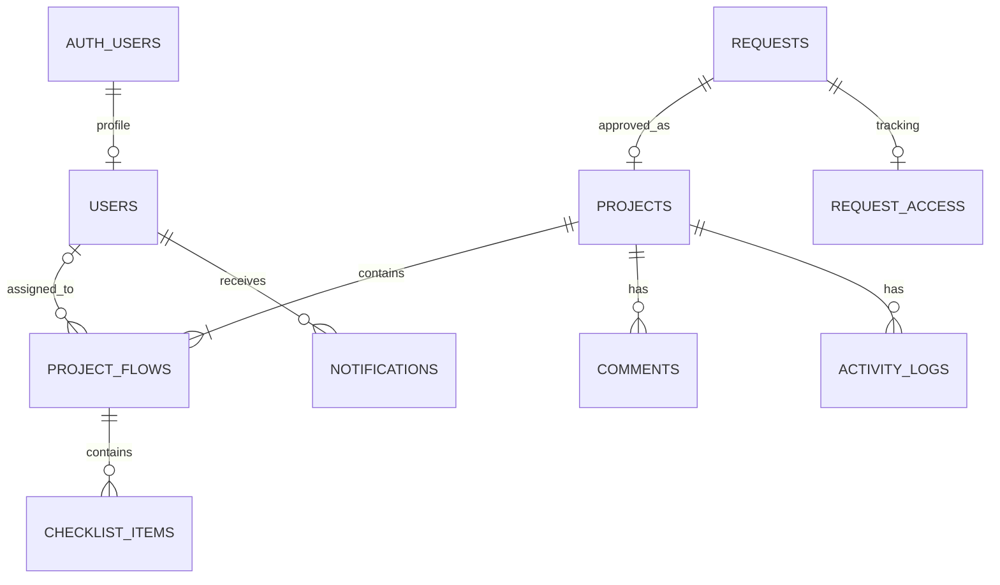

# FASE 2A — PostgreSQL, migraciones y seguridad

**Actualización técnica 2B.3D:** [resolución de bloqueos](fase-2b3d-resolucion-bloqueos.md)
sustituye los triggers de perfil en Auth por provisión privada explícita y
actualiza recuperación/historial. La evidencia de 72 pruebas es histórica; no
se repitió ni se atribuye a la migración 3 revisada. Véanse las siete pruebas nuevas.

Fecha: 17/11/2026. Base de trabajo: commit `827489b` de FASE 1.
Destino previsto: proyecto independiente `ticketera-procont`, todavía sin
conexión desde este repositorio.

## Alcance y archivos

Se reconstruyó el esquema requerido por las consultas de `src/`, conservando
las ocho entidades actuales y sus campos. No se modificaron componentes,
hooks, identidad visual, paquetes, lockfile ni configuración de compilación.
Se reutiliza la compilación satisfactoria de FASE 1; no se repitió `npm ci`
ni la compilación de frontend porque no cambiaron sus entradas.

| Archivo | Contenido |
|---|---|
| `supabase/migrations/20261117000100_schema.sql` | Esquema inicial, integridad, índices, acceso cerrado |
| `supabase/migrations/20261117000200_security.sql` | RLS, roles y permisos por columna |
| `supabase/migrations/20261117000300_operations.sql` | Triggers, Auth y RPC transaccionales |
| `supabase/migrations/20261117000400_reference_checklists.sql` | Configuración genérica de 35 pasos de checklist |
| `supabase/tests/support/auth_stub.sql` | Simulación mínima de Auth, solo para pruebas locales |
| `supabase/tests/behavior.sql` | Casos ficticios y 72 comprobaciones SQL |
| `supabase/tests/run_local.py` | Ejecución aislada, concurrencia y compatibilidad estática |
| `docs/validation/fase-2a-local.txt` | Salida de la validación final |
| `supabase/README.md` | Secuencia y separación de migraciones/pruebas |

Ningún SQL antiguo de la raíz forma parte de esta secuencia. No se incorporaron
sus cuentas, contraseñas, datos de negocio, áreas ni identificadores remotos.
No se creó `supabase/seed.sql`. Los únicos registros de referencia son tareas
genéricas de flujo tomadas de `src/lib/checklist-defaults.ts`, con la misma
descripción y orden. Las cuentas y registros ficticios viven solo en pruebas.

## Esquema

Los UUID se generan en PostgreSQL. Los estados y tipos se expresan mediante
`text` y restricciones `CHECK`, para poder evolucionarlos con migraciones.
Las columnas de texto tienen límites de longitud y las obligatorias rechazan
valores vacíos. Las fechas técnicas usan `timestamptz`; los plazos usan `date`.

| Tabla pública | Relación y restricciones principales |
|---|---|
| `users` | Perfil 1:1 con `auth.users`; roles permitidos y activación controlada; eliminación Auth propaga al perfil |
| `requests` | Número único REQ/INT; estado; datos de solicitante; vínculo opcional y único a proyecto; rechazar exige motivo |
| `projects` | Una solicitud obligatoria y única por proyecto; número espejo de solicitud; tipo, prioridad, estado, SLA y bloqueo; vencimiento no anterior al inicio |
| `project_flows` | Un flujo por proyecto/tipo; responsable opcional; progreso entero 0–100; fase válida según flujo |
| `checklist_items` | Pertenencia a un flujo; fase válida; texto, orden y estado; fecha de completado coherente |
| `comments` | Proyecto y autor; autor predeterminado desde `auth.uid()` |
| `activity_logs` | Historial operativo por proyecto; autor, acción y JSON acotado |
| `notifications` | Destinatario obligatorio; proyecto opcional; cuatro tipos actuales; lectura individual |
| `checklist_templates` | Configuración por flujo/fase/posición, sin duplicar posiciones de plantilla |

`tags` no se reconstruyó: no hay consultas vigentes a esa tabla en `src/`.
Tampoco existe una tabla `tasks`: las tareas internas son `checklist_items` y
la importación de Planner genera solicitudes pendientes.

El esquema privado `app_private` no debe exponerse mediante la Data API:

| Tabla | Finalidad |
|---|---|
| `number_counters` | Contador separado por serie y año completo |
| `request_access` | Token aleatorio UUID para seguimiento de una solicitud |
| `rpc_calls` | Clave, actor, operación, entrada y respuesta de idempotencia |
| `security_events` | Cambios de permisos, bootstrap y eliminación definitiva |

Estas tablas tienen RLS habilitado y no tienen acceso directo para `anon` ni
`authenticated`. Los tokens y respuestas de idempotencia son datos sensibles
privados; no se incluyen en las tablas públicas ni en el historial operativo.
No se ha definido aún una política de caducidad o retención.



Se preservan `projects.request_id` y `requests.project_id`, porque ambos son
utilizados por el frontend. Son FK diferibles y únicas. Triggers de restricción
verifican al terminar la transacción que los vínculos sean recíprocos, que una
solicitud aprobada tenga exactamente su proyecto y que los números coincidan.
Una solicitud pendiente o rechazada no puede conservar un proyecto.

Otros triggers diferibles exigen exactamente los flujos del tipo de proyecto:
uno de desarrollo, uno administrativo o ambos para `dual`. Las operaciones
transaccionales crean y reconcilian esos flujos antes del commit. No se admite
dejar un proyecto sin flujo y completarlo mediante otra petición HTTP.

Las FK de comentarios, flujos, checklist y notificaciones de proyecto permiten
eliminar sus dependientes al purgar un proyecto. Antes de esa eliminación, la
RPC conserva la solicitud como rechazada, con motivo y sin vínculo. Los autores
históricos y responsables pasan a NULL si se elimina su perfil. No se concede
borrado directo de perfiles ni proyectos al cliente.

Los índices cubren claves únicas, estado/fecha de solicitudes y proyectos,
vencimiento SLA, responsable, checklist por flujo/fase/orden, comentarios y
actividad por proyecto, y notificaciones por destinatario/fecha. No se añadió
unicidad de posición al checklist de instancia: el reordenamiento actual envía
varios updates independientes y esa restricción produciría colisiones.

## Matriz de seguridad

Modelo inicial: un único espacio de trabajo compartido. La asignación expresa
responsabilidad, no constituye una ACL por proyecto. Este criterio conserva
los tableros y métricas generales actuales; no presupone nuevas áreas ni equipos.
Todo acceso interno requiere un perfil activo consultado en la base de datos,
sin confiar en roles enviados en formularios o metadatos de registro.

| Operación | Público/anon | Viewer activo | Developer activo | Admin activo | Superadmin activo |
|---|---|---|---|---|---|
| Leer tablas de negocio | No | Sí | Sí | Sí | Sí |
| Ver papelera y sus registros vinculados | No | No | No | Sí | Sí |
| Enviar solicitud pública por RPC | Sí | Sí | Sí | Sí | Sí |
| Seguimiento por número + token | Sí | Sí | Sí | Sí | Sí |
| Crear proyecto interno por RPC | No | No | Sí | Sí | Sí |
| Aprobar/rechazar solicitud por RPC | No | No | No | Sí | Sí |
| Editar proyecto/flujo/checklist | No | No | Sí | Sí | Sí |
| Cambiar tipo y reconciliar flujos por RPC | No | No | Sí | Sí | Sí |
| Enviar comentario/actividad operativa | No | No | Sí | Sí | Sí |
| Borrar/restaurar a papelera; purgar por RPC | No | No | No | Sí | Sí |
| Editar plantillas genéricas | No | No | No | Sí | Sí |
| Cambiar nombre del perfil propio | No | Sí | Sí | Sí | Sí |
| Activar/asignar viewer o developer | No | No | No | Sí, sobre perfiles sin rol administrativo | Sí |
| Administrar roles admin/superadmin | No | No | No | No | Sí |
| Leer/marcar notificaciones propias | No | Sí | Sí | Sí | Sí |

Un JWT de un usuario inactivo no permite lecturas internas ni RPC de editor o
administrador. Las dos operaciones públicas continúan siendo públicas para
cualquier solicitante; no conceden acceso a las tablas.

La lectura de `users` es un directorio interno para miembros activos, incluyendo
nombre, correo, rol y estado. No se introdujo una separación de directorios por
área que todavía no está definida. Las notificaciones solo son legibles por su
destinatario, incluso para administradores. Los editores pueden emitir los
tipos de notificación existentes a usuarios activos.

Los permisos por columna protegen `role`, `is_active`, IDs, números, enlaces,
tipo de proyecto y autoría. El cliente no puede modificarlos mediante una
actualización genérica aunque tenga permiso sobre otras columnas de la tabla.
Las RPC administrativas validan el rol del actor; un admin no puede gestionar
perfiles administrativos ni conceder esos roles. Un advisory lock común impide
eliminar al último superadmin activo mediante llamadas concurrentes.

Los permisos de funciones se revocan explícitamente de `PUBLIC`, `anon`,
`authenticated` y `service_role` antes de conceder solo los necesarios a la API.
Todas las funciones `SECURITY DEFINER` fijan `search_path=''`, usan tablas con
esquema explícito y no aceptan SQL del cliente. Los administradores de la base
de datos y el acceso privilegiado de plataforma siguen siendo de confianza;
RLS no convierte una clave `service_role` en una credencial de navegador.

`activity_logs` mantiene el historial operativo del cliente actual y puede
recibir acciones de editores con su propia autoría. No se utiliza como auditoría
de seguridad confiable. Los cambios privilegiados quedan en `security_events`,
sin grants de lectura o escritura para la API.

## Alta de usuarios y bootstrap

Desde 2B.3D no se instala un trigger de aplicación sobre `auth.users`.
El propietario invoca `app_private.provision_auth_profile(uuid)` después de una
administración Auth separadamente autorizada: crea un perfil viewer inactivo
desde una identidad existente, ignorando roles/activación en metadatos. Rechaza
identidad ausente o sin correo. El refresco explícito conserva nombre, rol y
activación existentes y actualiza correo; no hay sincronización automática.

En 2B, una vez que exista el usuario Auth inicial y su identidad esté definida,
el propietario de la base podrá invocar de forma controlada
`app_private.bootstrap_superadmin(uuid)`. Esta función no está concedida a la
API ni a `service_role` y solo funciona si no hay ya un superadmin activo.
No se invocó sobre ninguna base externa. Un nuevo registro público nunca se
convierte en superadmin por ser el primer usuario.

La provisión de cuentas adicionales mediante Auth Admin deberá realizarse en
un backend de confianza. La administración visual actual basada en `signUp`
y posterior `insert users` necesita adaptación: el perfil debe provisionarse por
el propietario y queda inactivo hasta que un administrador autorizado lo habilite.
La eliminación definitiva de cuentas Auth y la edición administrativa del
nombre de otros perfiles quedan fuera de las RPC de esta fase; se mantiene
la desactivación y la edición del nombre propio.

## Operaciones transaccionales

Los nombres siguientes son funciones en `public` para llamadas `.rpc(...)`.
No se ha modificado ningún consumidor React.

| RPC | Parámetros | Resultado y efectos |
|---|---|---|
| `submit_request` | `p_payload jsonb`, `p_idempotency_key uuid` | Crea REQ pendiente, número, token privado e idempotencia; devuelve `{id, request_number, tracking_token}` |
| `track_request` | `p_request_number text`, `p_tracking_token uuid` | Devuelve estado, fechas y avance; devuelve NULL si no coincide; excluye nombre, correo y descripción |
| `create_internal_project` | `p_payload jsonb`, `p_idempotency_key uuid` | Crea solicitud interna INT y proyecto, todos los flujos/checklists y evento `created`; devuelve proyecto JSON |
| `approve_request` | `p_request_id uuid`, `p_payload jsonb`, `p_idempotency_key uuid` | Bloquea solicitud pendiente; crea proyecto, flujos/checklists, vínculos, historial y avisos a responsables; devuelve proyecto JSON |
| `reject_request` | `p_request_id uuid`, `p_reason text` | Rechaza únicamente una solicitud pendiente, sin proyecto; exige motivo |
| `change_project_type` | `p_project_id uuid`, `p_project_type text` | Bloquea proyecto; conserva flujos compatibles, elimina los incompatibles y crea los faltantes con checklist; devuelve fila de proyecto |
| `update_request_details` | `p_request_id uuid`, `p_area text`, `p_requester_name text` | Edita esos dos datos; respeta visibilidad de papelera; no permite cambiar estado, número o enlaces |
| `admin_update_user` | `p_user_id uuid`, `p_role text`, `p_is_active boolean` | Control jerárquico de permisos/activación; preserva último superadmin; registra auditoría privada |
| `purge_project` | `p_project_id uuid` | Solo admin/superadmin y proyecto en papelera; elimina dependientes y preserva solicitud coherente y auditoría privada |

Las tres RPC de alta/aprobación exigen una clave UUID aleatoria del cliente,
generada con `crypto.randomUUID()` y conservada durante los reintentos. La clave
se separa por operación y actor; para anon se utiliza un actor reservado. Un
advisory lock serializa reintentos concurrentes de la misma clave. La misma
entrada devuelve la respuesta original sin crear registros ni eventos nuevos;
una entrada diferente con la misma clave devuelve `22023`. El resultado
reproducido es una instantánea, por lo que el consumidor debe recargar el estado
actual después. Cambiar de sesión cambia el ámbito de idempotencia.

Las aprobaciones con claves diferentes también se serializan mediante bloqueo
de fila de solicitud: la segunda encuentra que ya no está pendiente y falla.
Las restricciones únicas impiden duplicar proyecto o flujo incluso con errores
del consumidor. Si falla cualquier paso, se revierten también numeración,
checklist, notificaciones y registro de idempotencia.

Los números usan un `INSERT ... ON CONFLICT DO UPDATE ... RETURNING` sobre
`(serie,año)`; no hay `MAX + 1` ni ordenamiento textual. Las series REQ e INT se
reinician por año en `America/Lima`. El formato mantiene dos dígitos de año y
al menos tres de contador, sin truncar el número 1000. La numeración pertenece
a la solicitud y el proyecto recibe el mismo número automáticamente. No se
aceptan números calculados por el navegador.

Campos permitidos por payload:

- `submit_request`: `requester_name`, `requester_email`, `requester_area`,
  `request_type`, `origin`, `data_system_involved`, `description`, `observations`,
  `request_date`, `requested_date`, `needs_code`. El área y los campos
  obligatorios deben estar presentes. No acepta `status` ni `project_id`.
- `create_internal_project`: `title`, `description`, `project_type`, `priority`,
  `start_date`, `due_date`, `sla_target_date`, `area`, `requester_name`,
  `assigned_dev`, `assigned_admin`. El área puede quedar sin definir; el nombre
  omitido toma el del actor. No utiliza áreas ni responsables prefijados.
- `approve_request`: `title`, `project_type`, `priority`, `start_date`, `due_date`,
  `sla_target_date`, `sla_formal_days`, `assigned_dev`, `assigned_admin`.
  Si se proporciona fecha SLA, se requieren días formales entre 1 y 3650.
  Una aprobación con SLA crea el evento `sla_started` dentro de la transacción.
  Con prioridad baja se elimina el compromiso SLA y no se crea ese evento.

Los payloads rechazan claves desconocidas/protegidas y objetos de más de 50 kB.
Las fechas son ISO o NULL. Los responsables opcionales deben ser perfiles
activos con rol de editor. Desactivar un perfil no reasigna automáticamente sus
flujos históricos. Cambiar de tipo de proyecto puede eliminar checklist del
flujo retirado, igual que el comportamiento actual; el consumidor deberá tratar
esa operación como un cambio con efectos sobre los datos del flujo.

No se fijó un catálogo SQL de áreas, personas o productos. El cálculo de días
hábiles y del plazo SLA por tipo de solicitud sigue siendo responsabilidad del
adaptador. **Aclaración 2B.3C:** el frontend aún contiene la matriz heredada;
su conservación funcional no la convierte en política aprobada para Procont.
Los nuevos parámetros se decidirán con el propietario antes del uso operativo,
sin importar el catálogo empresarial anterior. Las RPC admiten los valores
resultantes. La creación interna conserva su plazo explícito y no registra
inicio SLA automáticamente, como en el flujo manual actual.

La [revisión organizacional 2B.3C](fase-2b3c-adaptacion-procont.md) confirma por
inspección estática que las cuatro migraciones no contienen áreas ni personas
prefijadas. `requester_area` permite texto libre sin catálogo SQL; no existe una
pantalla ni tabla administrable de áreas. No se modifica el esquema ni se repiten
las pruebas de esta fase. Los roles, fases y la regla existente de prioridad
baja sin SLA se conservan como base funcional y se documentan para revisión.

## Compatibilidad y cambios necesarios en consumidores

Se comprobó que todos los campos escalares de las ocho interfaces vigentes de
`database.types.ts` existen. Se verificaron también las dos funciones de
relación `public.requests(public.projects)` y
`public.projects(public.requests)`, `STABLE`, `ROWS 1` y `SECURITY INVOKER`.
Estas relaciones calculadas resuelven las dos rutas FK sin ampliar permisos,
permitiendo conservar las lecturas `projects(..., requests(...))` y
`requests(..., projects(status))`. Las demás relaciones son FK convencionales.

La compatibilidad estática de nombres no equivale a integración completa. No
se ejecutaron PostgREST, GoTrue ni un navegador en estas pruebas.

| Código actual | Lectura/escritura prevista |
|---|---|
| `useProjects`, dashboard, carga de trabajo, papelera | Lecturas conservadas para los roles autorizados; Realtime publica proyectos y flujos |
| `useRequests.createRequest`, formulario público, importador Planner | Sustituir insert directo por `submit_request`; no cargar toda la bandeja desde el formulario público |
| `useRequests.getRequestByNumber`, `RequestTracking` | Solicitar/guardar token y usar `track_request`; no reabrir SELECT público para mantener búsqueda por número solo |
| `useRequests.approveRequest/rejectRequest` | Usar las RPC y enviar SLA calculado; retirar inserciones duplicadas de flujos, checklist e historial |
| `useProjects.createProject` | Usar `create_internal_project`; retirar numeración calculada en navegador y solicitud auxiliar por pasos |
| `useProjects.updateProject` | Edición ordinaria permitida; separar cambio de tipo hacia `change_project_type` |
| `ProjectModal` | Edición de área/solicitante por `update_request_details`; no insertar otra solicitud auxiliar |
| `useChecklist`, comentarios, actividad | Mantienen sus tablas y operaciones autorizadas; autor desde sesión y validaciones del servidor |
| Notificaciones | Lectura/marcado solo propios; envío por editores a perfiles activos; publicación habilitada |
| Eliminación definitiva en papelera | Sustituir DELETE directo por `purge_project` |
| `useUsers`, login y rutas protegidas | Adaptar provisión/Auth, cambios de permisos a RPC y tratamiento visual del usuario inactivo |

Se deberán generar tipos desde el esquema nuevo en 2B, incluyendo nulabilidad:
hay campos opcionales SQL NULL que las interfaces manuales actuales representan
solo con `?`; `requester_area` puede ser NULL en una solicitud interna sin área.
También conviene corregir el cálculo de deduplicación de avisos SLA: la consulta
actual solo podrá ver las notificaciones del actor, por diseño.

## Validación local y evidencia

Docker Desktop no tenía integración WSL y PostgreSQL no estaba instalado. Se
descargaron y extrajeron paquetes de PostgreSQL **18.6** y sus bibliotecas bajo
`/tmp/ticketera-procont-dbcheck`, sin instalar servicios ni dependencias del
proyecto. Se inicializó un clúster descartable con TCP deshabilitado y socket
privado. La base de cada ejecución se creó y eliminó allí. El servidor temporal
se detuvo después de la última ejecución.

El soporte Auth reproduce únicamente `auth.users`, `auth.uid()`, los roles y
defaults permisivos relevantes. No simula login, contraseñas, JWT firmados ni
la implementación completa de Supabase. El SQL usa características compatibles
con PostgreSQL 15+; la versión del remoto no se consultó.

La validación se realizó con un solo agente. Tras ampliar la cobertura y cerrar
la edición de metadatos de proyectos en papelera, la ejecución final produjo:

- Cuatro migraciones aplicadas sobre una base vacía.
- **72 comprobaciones SQL**, incluidos bootstrap, metadatos maliciosos de alta,
  escalada de rol, perfil inactivo, RLS por rol, autoría, notificaciones,
  rechazo, reciprocidad, FK, flujos, checklist, SLA, rollback y purga.
- **12 altas REQ concurrentes**, números únicos 999–1010.
- **8 altas INT concurrentes**, números únicos 999–1006.
- **4 reintentos concurrentes** de la misma alta INT: un único proyecto.
- **2 aprobaciones simultáneas** con claves diferentes: solo una se aplica.
- **2 cambios administrativos simultáneos**: queda un superadmin activo.
- Ocho interfaces TypeScript cotejadas con columnas SQL y ambas relaciones
  calculadas comprobadas como invoker, con pruebas de sus resultados.

La salida exacta está en [validation/fase-2a-local.txt](validation/fase-2a-local.txt).
No se repitió ninguna prueba mediante otro agente. La FASE 1 sigue siendo la
evidencia de instalación/compilación; todo `src/` y los manifiestos de paquetes
permanecen sin cambios respecto de `827489b`.

### Reproducción en un clúster ya aislado

El runner requiere Python estándar y `psql`. Rechaza hosts de red, elimina
variables `PG*` heredadas, exige directorios bajo `/tmp`, marcador explícito y
verifica `data_directory` y `listen_addresses` antes de crear una base.
No utiliza `.env` ni `DATABASE_URL`.

Ejemplo para el clúster temporal de esta ejecución, una vez iniciado nuevamente
solo por socket, con el marcador creado explícitamente:

```bash
LD_LIBRARY_PATH=/tmp/ticketera-procont-dbcheck/runtime/usr/lib/x86_64-linux-gnu \
python3 supabase/tests/run_local.py \
  --pg-bin /tmp/ticketera-procont-dbcheck/runtime/usr/lib/postgresql/18/bin \
  --socket /tmp/ticketera-procont-dbcheck/socket \
  --cluster /tmp/ticketera-procont-dbcheck/cluster
```

El marcador es `cluster/.procont-isolated-tests`. No marcar clústeres con datos
reales. El runner elimina exclusivamente su base aleatoria `procont_test_*` al
terminar y deja el ciclo de vida del servidor a cargo de quien lo inició.
No usar `tests/support/auth_stub.sql` en una base real.

## Pendientes y límite de FASE 2B

1. Confirmar versión, roles, propiedad de publicación y extensiones del nuevo
   entorno cuando se autorice la conexión; aplicar solo la secuencia nueva con
   un historial de migraciones. No mezclarla con los SQL antiguos.
2. Definir el usuario Auth inicial y ejecutar bootstrap de forma controlada;
   no hay una cuenta o contraseña inicial fijada en las migraciones.
3. Integrar los hooks/servicios con las RPC antes de esperar que funcionen las
   altas actuales. Coordinar contratos con el agente de frontend sin duplicar
   pruebas SQL ni modificar ahora sus componentes.
4. Probar las relaciones calculadas y Realtime mediante la versión real de
   PostgREST/Supabase, además de generar los tipos. No están validados por HTTP.
5. Definir cómo entregar y conservar el token de seguimiento. El número solo
   ya no es una credencial. Evitar tokens en logs o URLs que se compartan.
6. Añadir controles de abuso/rate limiting y, si se expone a Internet, el control
   de automatización correspondiente al formulario público. La RPC limita
   campos/tamaño y acceso, pero no limita el volumen de solicitudes por IP.
7. Definir retención de solicitudes, tokens, idempotencia y auditoría; confirmar
   áreas, responsables y reglas futuras sin importar configuraciones antiguas.
8. Mantener aparte la revisión de dependencias y los pendientes de FASE 1.

No se ha enlazado un proyecto remoto, utilizado credenciales anteriores,
ejecutado SQL externo, ejecutado scripts antiguos, actualizado dependencias,
hecho push/merge ni desplegado. Esta fase termina antes de aplicar migraciones
o configurar credenciales del Supabase remoto.

Referencias de diseño: [funciones seguras de Supabase](https://supabase.com/docs/guides/database/functions),
[seguridad de SECURITY DEFINER en PostgreSQL](https://www.postgresql.org/docs/current/sql-createfunction.html)
y [relaciones calculadas de PostgREST](https://docs.postgrest.org/en/stable/references/api/resource_embedding.html).
