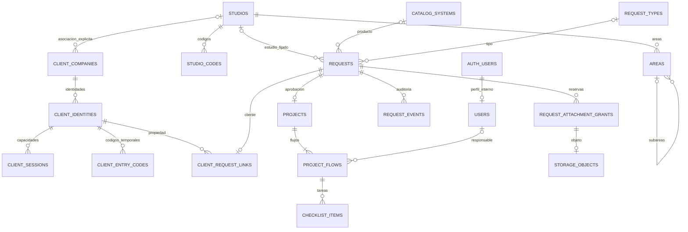

# Base de datos y migraciones M1–M16b

Revisión: **23/11/2026** · Código de referencia: **`2f9ab74aff3d612951596986490b5641a27f3932`** (tag `ticketera-production-20261123`, [release](../validation/production-release-20261123/REPORT.md)). Revisión anterior: 20/11/2026 sobre `c857a72`.

Fuente oficial de requisitos: [PRODUCT_REQUIREMENTS.md](PRODUCT_REQUIREMENTS.md).

## M16 + M16b — posteriores a M15

> **Producción 23/11/2026 15:55 UTC:** M16 (`20261123000100_client_request_data_security.sql`, sha256 `ecec0b9a…3f102`) y M16b (`20261123000200_client_legacy_payload_compat.sql`, sha256 `8adce4bb…d036`) **aplicadas** en `xsxdpaiivklqeudgqoqf`; historial 17/17 y funciones remotas idénticas a la instalación probada (107/107). [Activación](../validation/m16-activation-20261123/REPORT.md).

Revisión de esta ampliación: 23/11/2026; base `a61450c93f5180ecd623d945b100424a47a3a5d3`.
Historial remoto consultado el 23/11/2026 tras la activación: 17/17.
M16 y M16b **aplicadas** (ver aviso superior); texto original de preparación conservado. M16b (`20261123000200_client_legacy_payload_compat.sql`) solo reemplaza `public.submit_client_request` y `public.client_submit_request`; sin columnas, datos, RLS ni permisos nuevos. [Handoff](../validation/client-experience-contract-handoff.md), [informe](../../REPORT-backend-codex1.md).

| Archivo nuevo | Objetivo / datos |
|---|---|
| `20261123000100_client_request_data_security.sql` | Requests añade requested_priority, requested_subsystem_id y requester_name_source nullable; default medium separado conserva null histórico. FK compuesta hijo/producto. Snapshots privados username en enlaces/sesiones/códigos, unicidad de identidad con username exacto y NULLS NOT DISTINCT para empresa QuipuFac. Triggers conservan alcance/propiedad/entradas originales; RPC client_subprojects y reemplazos compatibles de creación/consulta/capacidades. |

M1–M15 sin cambios. Sin DML de migración sobre filas de negocio, relleno de históricos,
reasignaciones, catálogo nuevo ni cambio de propietarios. Prioridad solicitada no cambia urgencia,
métricas M11 ni prioridad administrativa. Clasificación interna puede cambiar subsystem_id sin
alterar el subproyecto original solicitado. QuipuFac comparte tickets por identidad empresarial.

PostgreSQL 15+ necesario por NULLS NOT DISTINCT; pruebas realizadas con 17.12. Instalación
limpia y actualización M15→M16 preservan todas las columnas anteriores. Rollback probado antes
de COMMIT en base desechable; no se autoriza un down remoto ni reabrir permisos M15.

## Estado y reglas de mantenimiento

Las **17 migraciones (M1–M16b) están aplicadas**: historial remoto 17/17 consultado el 23/11/2026 tras aplicar M16 y M16b ([release](../validation/production-release-20261123/REPORT.md)). Texto original de la revisión del 20/11: las 15 migraciones de entonces estaban aplicadas según evidencia remota de activación de M15 del 20/11/2026, conservada en [EVIDENCE_20261120.md](EVIDENCE_20261120.md). En esta revisión documental **no se ejecutó SQL ni se volvió a consultar la base**: se contrastó el historial conservado 15/15 con los quince nombres del commit y sus hashes. Management API se usó únicamente con GET para proyecto/funciones/configuración no secreta.

El SQL en `supabase/migrations/` es fuente de esquema. Archivos SQL en raíz, seeds, scripts de migración de formatos y compensaciones son antecedentes; no se ejecutan como instalación. M1–M16b no se editan ni se reenvían. Cambios futuros: migración nueva, revisión, pruebas y autorización específica. La existencia de scripts versionados de M1–M4 no autoriza aplicarlos contra el proyecto actual.

## Modelo y relaciones

Los nombres de diagrama representan tablas de `public`, `app_private`, `auth` y `storage`; la relación reserva→objeto se resuelve por ruta/id y metadatos, no todas las aristas son FK declaradas. Solicitud→proyecto tiene FK diferidas para inserción atómica. Una solicitud pending/rejected no tiene proyecto. Un proyecto histórico Dual puede tener dos flujos; uno nuevo tiene solo Development.

| Dominio | Tablas y datos relevantes |
|---|---|
| Identidades internas | `auth.users` administrada por Supabase y `public.users`: correo, full_name, role, is_active; alta explícita, no roles desde metadata. |
| Solicitud | `public.requests`: UUID, serie/REQ, solicitante, tipo/título/descripción/urgencia, estudio/sistema/clasificación, decisión y proyecto; sin columna general_status persistida. |
| Proyecto/flujo | `projects`: workflow_version, prioridad, tipo/estado, fechas y bloqueo; `project_flows`: tipo/fase/responsable y progress histórico de solo lectura para app. |
| Checklist | `checklist_templates` referencia; `checklist_items` por flujo/fase, completed/order_index/completed_at con validación y auditoría. |
| Colaboración | `comments`, `notifications`, `activity_logs` históricos y `request_events` actuales; `app_private.security_events` para administración. |
| Catálogos | `catalog_systems`, `catalog_subsystems`, `studios`, `studio_codes`, `areas`, `request_types`; desactivar en vez de borrar. |
| Transacciones | `app_private.number_counters` por serie/año; `rpc_calls` por operación/actor/clave; `request_access` capacidad de recibo. |
| Clientes | `client_companies` con RUC y explicit_studio_id; `client_identities`; `client_sessions` (solo hash); `client_entry_codes`; bindings de productos; `client_request_links`. |
| Administración | `account_bootstrap` marcador inicial persistente; `account_admin_jobs` reconciliación, sin contraseña/token. |
| Seguridad operativa | `request_attachment_grants`, `public_tracking_hits`, `client_login_attempts`, `board_command_context` transaccional privado. |
| Storage | `storage.buckets`/`storage.objects` administradas; bucket privado request-attachments; tamaño/MIME reales y FK lógicas a reserva. |

## Tabla de migraciones

| Nº | Archivo exacto | Objetivo | Estado remoto conocido |
|---|---|---|---|
| M1 | [20261117000100_schema.sql](../../supabase/migrations/20261117000100_schema.sql) | Schema | APLICADA; evidencia 20/11/2026, historial 15/15 |
| M2 | [20261117000200_security.sql](../../supabase/migrations/20261117000200_security.sql) | Security | APLICADA; evidencia 20/11/2026, historial 15/15 |
| M3 | [20261117000300_operations.sql](../../supabase/migrations/20261117000300_operations.sql) | Operations | APLICADA; evidencia 20/11/2026, historial 15/15 |
| M4 | [20261117000400_reference_checklists.sql](../../supabase/migrations/20261117000400_reference_checklists.sql) | Reference checklists | APLICADA; evidencia 20/11/2026, historial 15/15 |
| M5 | [20261118000100_account_administration.sql](../../supabase/migrations/20261118000100_account_administration.sql) | Account administration | APLICADA; evidencia 20/11/2026, historial 15/15 |
| M6 | [20261118000200_areas.sql](../../supabase/migrations/20261118000200_areas.sql) | Areas | APLICADA; evidencia 20/11/2026, historial 15/15 |
| M7 | [20261118000300_ticket_catalogs.sql](../../supabase/migrations/20261118000300_ticket_catalogs.sql) | Ticket catalogs | APLICADA; evidencia 20/11/2026, historial 15/15 |
| M8 | [20261118000400_request_intake.sql](../../supabase/migrations/20261118000400_request_intake.sql) | Request intake | APLICADA; evidencia 20/11/2026, historial 15/15 |
| M9 | [20261118000500_ticket_security.sql](../../supabase/migrations/20261118000500_ticket_security.sql) | Ticket security | APLICADA; evidencia 20/11/2026, historial 15/15 |
| M10 | [20261118000600_request_tracking.sql](../../supabase/migrations/20261118000600_request_tracking.sql) | Request tracking | APLICADA; evidencia 20/11/2026, historial 15/15 |
| M11 | [20261118000700_business_metrics.sql](../../supabase/migrations/20261118000700_business_metrics.sql) | Business metrics | APLICADA; evidencia 20/11/2026, historial 15/15 |
| M12 | [20261118000800_board_operations.sql](../../supabase/migrations/20261118000800_board_operations.sql) | Board operations | APLICADA; evidencia 20/11/2026, historial 15/15 |
| M13 | [20261119000100_client_access.sql](../../supabase/migrations/20261119000100_client_access.sql) | Client access | APLICADA; evidencia 20/11/2026, historial 15/15 |
| M14 | [20261119000200_client_login_throttle.sql](../../supabase/migrations/20261119000200_client_login_throttle.sql) | Client login throttle | APLICADA; evidencia 20/11/2026, historial 15/15 |
| M15 | [20261119000300_security_request_creation.sql](../../supabase/migrations/20261119000300_security_request_creation.sql) | Security request creation | APLICADA; evidencia 20/11/2026, historial 15/15 |
| M16 | [20261123000100_client_request_data_security.sql](../../supabase/migrations/20261123000100_client_request_data_security.sql) | Identidad Quipu/QuipuFac, prioridad solicitada, subproyecto original, procedencia del nombre, `client_subprojects` | APLICADA 23/11/2026 15:55 UTC; historial 17/17 |
| M16b | [20261123000200_client_legacy_payload_compat.sql](../../supabase/migrations/20261123000200_client_legacy_payload_compat.sql) | Compatibilidad con el frontend anterior (nombre Quipu descartado; NULL sin clave `subsystem_id`) | APLICADA 23/11/2026 15:55 UTC; historial 17/17 |

## Especificación por migración

### M1 — Schema

**Objetivo:** Modelo inicial independiente: nueve tablas públicas y cuatro privadas, índices, constraints y RLS cerrado por defecto.

| Aspecto | Detalle |
|---|---|
| Archivo / integridad | `20261117000100_schema.sql`; SHA-256 `4cc433c7eb91278abf020b82d9e40ddc39052642630db267e0753bf2c4f5fbcd`. |
| Tablas nuevas | `public.users`, `public.requests`, `public.projects`, `public.project_flows`, `public.checklist_templates`, `public.checklist_items`, `public.comments`, `public.activity_logs`, `public.notifications`, `app_private.number_counters`, `app_private.request_access`, `app_private.rpc_calls`, `app_private.security_events` |
| Funciones creadas o sustituidas | `app_private.valid_phase` |
| Triggers | No declara triggers literales nuevos; revisar bucles y funciones sustituidas si corresponde. |
| Políticas | Sin políticas literales nuevas; conserva/restringe ACL y validaciones del esquema acumulado. |
| Dependencias | Supabase PostgreSQL, esquemas Auth/Storage y roles administrados. |
| Cambios de datos | Instalación limpia; no copia datos ni crea Auth. |
| Riesgos / preservación | Requiere esquemas/roles Supabase; no ejecutar sobre un esquema legado poblado. |
| Prueba y evidencia | [supabase/tests/run_local.py](../../supabase/tests/run_local.py); [docs/validation/fase-2b3d-local.json](../../docs/validation/fase-2b3d-local.json). |

### M2 — Security

**Objetivo:** Grants por columna y RLS de workspace para perfiles activos; lectura/escritura según rol.

| Aspecto | Detalle |
|---|---|
| Archivo / integridad | `20261117000200_security.sql`; SHA-256 `669171a4a000c4dbfeb78ca53e4c58df3b7ba9473c7735ef4d024047d5bf8cf5`. |
| Tablas nuevas | Sin tablas nuevas; modifica funciones/permisos o estructuras existentes. |
| Funciones creadas o sustituidas | `app_private.has_role`, `app_private.can_read_project` |
| Triggers | No declara triggers literales nuevos; revisar bucles y funciones sustituidas si corresponde. |
| Políticas | `member_read`, `member_read`, `member_read`, `member_read`, `member_read`, `member_read`, `member_read`, `own_profile`, `editor_update`, `editor_update`, `editor_insert`, `editor_update`, `editor_delete`, `admin_templates`, `editor_comment`, `editor_activity`, `own_notifications`, `own_notification_read`, `editor_notification` |
| Dependencias | Prefijo M1–M1 aplicado en orden; contratos de objetos de ese prefijo. |
| Cambios de datos | Sin DML de negocio. |
| Riesgos / preservación | Políticas iniciales se restringen luego en M8/M12/M15; no leerlas aisladamente como permisos finales. |
| Prueba y evidencia | [supabase/tests/run_local.py](../../supabase/tests/run_local.py); [docs/validation/integration-security-client-flow.json](../../docs/validation/integration-security-client-flow.json). |

### M3 — Operations

**Objetivo:** Numeración anual Lima, locks, idempotencia, alta interna, aprobación/rechazo y consistencia solicitud/proyecto/flujos.

| Aspecto | Detalle |
|---|---|
| Archivo / integridad | `20261117000300_operations.sql`; SHA-256 `06b2bf5b0d5275c1e3d95b1848983c4242610f45d28a611fca256e3e696d206a`. |
| Tablas nuevas | Sin tablas nuevas; modifica funciones/permisos o estructuras existentes. |
| Funciones creadas o sustituidas | `app_private.touch_updated_at`, `app_private.provision_auth_profile`, `app_private.bootstrap_superadmin`, `app_private.next_number`, `app_private.request_number`, `app_private.project_number`, `app_private.check_request_project`, `app_private.check_project_flows`, `app_private.validate_assignment`, `app_private.validate_checklist`, `app_private.assert_payload`, `app_private.require_role`, `app_private.replay`, `app_private.remember`, `app_private.add_flows`, `public.submit_request`, `public.track_request`, `public.create_internal_project`, `public.approve_request`, `public.reject_request`, `public.change_project_type`, `public.update_request_details`, `public.admin_update_user`, `public.purge_project`, `public.requests`, `public.projects` |
| Triggers | `touch_updated_at`, `request_number`, `project_number`, `request_project_consistency`, `project_request_consistency`, `project_flow_consistency`, `flow_project_consistency`, `validate_assignment`, `validate_checklist` |
| Políticas | Sin políticas literales nuevas; conserva/restringe ACL y validaciones del esquema acumulado. |
| Dependencias | Prefijo M1–M2 aplicado en orden; contratos de objetos de ese prefijo. |
| Cambios de datos | Funciones y triggers; no crear cuentas ni solicitudes al migrar. |
| Riesgos / preservación | Provisión de perfil explícita del propietario, sin trigger en auth.users; guards posteriores sustituyen operaciones iniciales. |
| Prueba y evidencia | [supabase/tests/behavior.sql](../../supabase/tests/behavior.sql); [docs/validation/integration-security-client-flow.json](../../docs/validation/integration-security-client-flow.json). |

### M4 — Reference checklists

**Objetivo:** Carga de 35 tareas de referencia en checklist_templates.

| Aspecto | Detalle |
|---|---|
| Archivo / integridad | `20261117000400_reference_checklists.sql`; SHA-256 `2ae7b98b460a040319e0c2007809c1842374e97cb2ee4ac140a8fdfc48b0b145`. |
| Tablas nuevas | Sin tablas nuevas; modifica funciones/permisos o estructuras existentes. |
| Funciones creadas o sustituidas | Sin definiciones nuevas literales; políticas/plantillas. |
| Triggers | No declara triggers literales nuevos; revisar bucles y funciones sustituidas si corresponde. |
| Políticas | Sin políticas literales nuevas; conserva/restringe ACL y validaciones del esquema acumulado. |
| Dependencias | Prefijo M1–M3 aplicado en orden; contratos de objetos de ese prefijo. |
| Cambios de datos | INSERT de plantillas, no tareas ni proyectos reales. |
| Riesgos / preservación | Plantillas de referencia no son política nueva de esfuerzo/SLA; no inventar tareas Analysis/Code Review. |
| Prueba y evidencia | [supabase/tests/run_local.py](../../supabase/tests/run_local.py); [docs/validation/continuacion-af3259f-baseline.json](../../docs/validation/continuacion-af3259f-baseline.json). |

### M5 — Account administration

**Objetivo:** Bootstrap único y jobs de creación/invitación; aislamiento del actor y protección del último superadmin.

| Aspecto | Detalle |
|---|---|
| Archivo / integridad | `20261118000100_account_administration.sql`; SHA-256 `66f0a0df721c29152bf2a7fe8e4e4a1c269a36f3dacb66e650d0f578a725f16e`. |
| Tablas nuevas | `app_private.account_bootstrap`, `app_private.account_admin_jobs` |
| Funciones creadas o sustituidas | `app_private.authorize_account_actor`, `app_private.set_account_permissions`, `public.admin_update_user`, `app_private.bootstrap_superadmin`, `public.admin_account_begin`, `public.admin_account_record`, `public.admin_account_finish` |
| Triggers | No declara triggers literales nuevos; revisar bucles y funciones sustituidas si corresponde. |
| Políticas | Sin políticas literales nuevas; conserva/restringe ACL y validaciones del esquema acumulado. |
| Dependencias | Prefijo M1–M4 aplicado en orden; contratos de objetos de ese prefijo. |
| Cambios de datos | Crea tablas privadas, sin cuentas Auth ni perfiles reales por migración. |
| Riesgos / preservación | Auth y DB no comparten transacción distribuida; outcome desconocido requiere reconciliación por request_id. |
| Prueba y evidencia | [supabase/tests/account_admin_local.py](../../supabase/tests/account_admin_local.py); [docs/validation/account-administration-local.json](../../docs/validation/account-administration-local.json). |

### M6 — Areas

**Objetivo:** Catálogo inicial de áreas, nombres únicos insensibles a mayúsculas y administración superadmin.

| Aspecto | Detalle |
|---|---|
| Archivo / integridad | `20261118000200_areas.sql`; SHA-256 `e5c8d8f6f68ead3fb9088ccde36b1d3460dd54ff8de71d011e3586366923d16a`. |
| Tablas nuevas | `public.areas` |
| Funciones creadas o sustituidas | Sin definiciones nuevas literales; políticas/plantillas. |
| Triggers | `touch_updated_at` |
| Políticas | `areas_public_read`, `areas_member_read`, `areas_superadmin_read`, `areas_superadmin_insert`, `areas_superadmin_update` |
| Dependencias | Prefijo M1–M5 aplicado en orden; contratos de objetos de ese prefijo. |
| Cambios de datos | Catálogo inicial vacío; requester_area histórico permanece texto. |
| Riesgos / preservación | M7 agrega jerarquía/estudio y cambia unicidad; no documentar todavía la unicidad global M6 como regla final. |
| Prueba y evidencia | [supabase/tests/areas_local.py](../../supabase/tests/areas_local.py); [docs/validation/areas-remote.json](../../docs/validation/areas-remote.json). |

### M7 — Ticket catalogs

**Objetivo:** Productos/subproductos, estudios/códigos, áreas jerárquicas y clasificación inicial.

| Aspecto | Detalle |
|---|---|
| Archivo / integridad | `20261118000300_ticket_catalogs.sql`; SHA-256 `cfa7af9868184011cb2fa08d45dcba54d1559146b39f7e38bac6974af3b747b1`. |
| Tablas nuevas | `public.catalog_systems`, `public.catalog_subsystems`, `public.studios`, `public.studio_codes` |
| Funciones creadas o sustituidas | `app_private.check_area_hierarchy`, `app_private.guard_request_classification`, `public.submit_classified_request`, `public.assign_request_studio_code` |
| Triggers | `check_area_hierarchy`, `guard_request_classification`, `touch_updated_at` |
| Políticas | `member_read_active`, `superadmin_read`, `superadmin_insert`, `superadmin_update`, `public_read_active` |
| Dependencias | Prefijo M1–M6 aplicado en orden; contratos de objetos de ese prefijo. |
| Cambios de datos | Carga datos organizacionales: 7 productos, 8 subproductos, 9 estudios, 14 códigos, 5 áreas raíz y 14 subáreas. |
| Riesgos / preservación | RUC compartido no fusiona estudios; nombre de producto no equivale a proyecto de tablero. |
| Prueba y evidencia | [supabase/tests/ticket_catalogs_local.py](../../supabase/tests/ticket_catalogs_local.py); [docs/validation/ticket-catalogs-remote.json](../../docs/validation/ticket-catalogs-remote.json). |

### M8 — Request intake

**Objetivo:** Tipos de solicitud, título/urgencia, eventos, clasificación administrativa y bucket privado.

| Aspecto | Detalle |
|---|---|
| Archivo / integridad | `20261118000400_request_intake.sql`; SHA-256 `92bc5dd2dcee53ccfcdcb61ec63e1dd6f1db30e060e087dcbe2b84d8936bdc06`. |
| Tablas nuevas | `public.request_types`, `public.request_events` |
| Funciones creadas o sustituidas | `app_private.guard_request_classification`, `app_private.log_request_event`, `public.submit_client_request`, `public.classify_request`, `public.track_request`, `public.request_attachment_allowed` |
| Triggers | `touch_updated_at`, `log_request_event` |
| Políticas | `public_read_active`, `member_read_active`, `superadmin_read`, `superadmin_insert`, `superadmin_update`, `member_read`, `procont_request_attachments_insert`, `procont_request_attachments_read` |
| Dependencias | Prefijo M1–M7 aplicado en orden; contratos de objetos de ese prefijo. |
| Cambios de datos | Carga nueve tipos; bucket y políticas; no crear tickets. |
| Riesgos / preservación | Contrato público de M8 fue sustituido por M13 y cerrado en M15. Sus límites iniciales de 5 archivos/10 MiB no son vigentes. |
| Prueba y evidencia | [supabase/tests/request_intake_local.py](../../supabase/tests/request_intake_local.py); [docs/validation/request-intake-remote.json](../../docs/validation/request-intake-remote.json). |

### M9 — Ticket security

**Objetivo:** Reservas opacas y cuota decimal; trigger diferido valida bytes/MIME; motivo público separado de notas internas.

| Aspecto | Detalle |
|---|---|
| Archivo / integridad | `20261118000500_ticket_security.sql`; SHA-256 `af982fb3388d1dd1ae4f9ee02b2aa843ec107e087f2b30b318cc34a99805094b`. |
| Tablas nuevas | `app_private.request_attachment_grants` |
| Funciones creadas o sustituidas | `public.reserve_request_attachment`, `public.reserve_request_attachments`, `public.request_attachment_allowed`, `app_private.enforce_attachment_bytes`, `app_private.reject_with_public_message`, `public.reject_request`, `public.reject_request_with_notes`, `public.publish_rejection_reason`, `public.track_request` |
| Triggers | `procont_attachment_final_size` |
| Políticas | Sin políticas literales nuevas; conserva/restringe ACL y validaciones del esquema acumulado. |
| Dependencias | Prefijo M1–M8 aplicado en orden; contratos de objetos de ese prefijo. |
| Cambios de datos | Actualiza límite del bucket a 2500000; columna nueva sin publicar automáticamente motivos históricos. |
| Riesgos / preservación | Conservar objetos anteriores y tratar tamaños desconocidos como revisión; no asumir cero. |
| Prueba y evidencia | [supabase/tests/ticket_security_local.py](../../supabase/tests/ticket_security_local.py); [docs/validation/ticket-security-remote.json](../../docs/validation/ticket-security-remote.json). |

### M10 — Request tracking

**Objetivo:** Siete estados generales, seguimiento público mínimo y límites por minuto; eventos de fases/bloqueos.

| Aspecto | Detalle |
|---|---|
| Archivo / integridad | `20261118000600_request_tracking.sql`; SHA-256 `089c1764f3e54ac689063ab3b8ba3092e154bdb3ae51c11ec58c374746528635`. |
| Tablas nuevas | `app_private.public_tracking_hits` |
| Funciones creadas o sustituidas | `app_private.final_phase`, `app_private.request_general_status`, `app_private.sync_request_status`, `app_private.trg_request_status`, `app_private.trg_review_event_status`, `app_private.trg_flow_phase`, `app_private.trg_project_block`, `public.start_request_review`, `public.track_request_status` |
| Triggers | `sync_request_status`, `sync_review_status`, `sync_flow_phase`, `sync_project_block` |
| Políticas | Sin políticas literales nuevas; conserva/restringe ACL y validaciones del esquema acumulado. |
| Dependencias | Prefijo M1–M9 aplicado en orden; contratos de objetos de ese prefijo. |
| Cambios de datos | Añade eventos baseline de estado de solicitudes existentes; no cambia sus filas. |
| Riesgos / preservación | Baseline no confirma fechas reales de finalización; seguimiento incrementa contadores aun siendo una consulta funcional. |
| Prueba y evidencia | [supabase/tests/request_tracking_local.py](../../supabase/tests/request_tracking_local.py); [docs/validation/request-tracking-remote.json](../../docs/validation/request-tracking-remote.json). |

### M11 — Business metrics

**Objetivo:** Nombre obligatorio normalizado, primera salida de Backlog, cierre confiable y métricas/cohortes/urgencias.

| Aspecto | Detalle |
|---|---|
| Archivo / integridad | `20261118000700_business_metrics.sql`; SHA-256 `e1241afcdfd28649612a139efb5f2ab1fe6991b40f32c137e7d6695ec7d03a66`. |
| Tablas nuevas | Sin tablas nuevas; modifica funciones/permisos o estructuras existentes. |
| Funciones creadas o sustituidas | `app_private.normalize_requester_name`, `app_private.require_public_requester_name`, `public.submit_client_request`, `app_private.lock_flow_project_metrics`, `app_private.sync_request_status`, `app_private.trg_flow_phase`, `app_private.ticket_performance`, `public.get_ticket_performance`, `public.get_ticket_performance_summary`, `public.get_requester_urgency_month`, `app_private.metrics_month`, `public.metrics_monthly_urgency`, `public.metrics_requester_urgency`, `public.metrics_time_averages` |
| Triggers | `require_public_requester_name`, `serialize_flow_metrics` |
| Políticas | Sin políticas literales nuevas; conserva/restringe ACL y validaciones del esquema acumulado. |
| Dependencias | Prefijo M1–M10 aplicado en orden; contratos de objetos de ese prefijo. |
| Cambios de datos | No backfill ni modificación de solicitudes históricas; eventos nuevos usan reloj efectivo. |
| Riesgos / preservación | Null/cronología desconocida se conservan; no inferir updated_at ni SLA. |
| Prueba y evidencia | [supabase/tests/business_metrics_local.py](../../supabase/tests/business_metrics_local.py); [docs/validation/business-metrics-local.json](../../docs/validation/business-metrics-local.json). |

### M12 — Board operations

**Objetivo:** Development de ocho fases, comandos, auditabilidad, progresos separados, bloqueo/Done/reapertura y evidencia interna.

| Aspecto | Detalle |
|---|---|
| Archivo / integridad | `20261118000800_board_operations.sql`; SHA-256 `66995addf02ce4af8d53b6794fd030f4369ed88a02284d8815afe99e0dafc6be`. |
| Tablas nuevas | `app_private.board_command_context` |
| Funciones creadas o sustituidas | `app_private.valid_phase`, `app_private.board_phases`, `app_private.board_context`, `app_private.board_event`, `app_private.board_project_guard`, `app_private.board_flow_guard`, `app_private.board_assignment_audit`, `app_private.board_priority_audit`, `app_private.board_checklist_lock`, `app_private.board_checklist_audit`, `app_private.immutable_board_history`, `app_private.board_snapshot`, `public.get_board_ticket`, `app_private.board_apply`, `public.operate_board_ticket`, `public.operate_board_tickets`, `app_private.sync_request_status`, `app_private.trg_flow_phase`, `app_private.trg_project_block`, `app_private.board_creation_payload`, `public.create_internal_project`, `public.approve_request`, `public.change_project_type`, `public.purge_project`, `public.reserve_board_evidence`, `public.request_attachment_allowed`, `app_private.enforce_attachment_bytes` |
| Triggers | `board_project_guard`, `board_flow_guard`, `board_assignment_audit`, `board_priority_audit`, `board_checklist_lock`, `board_checklist_audit`, `immutable_board_history`, `immutable_board_history`, `immutable_board_history`, `immutable_board_history_truncate`, `immutable_board_history_truncate`, `immutable_board_history_truncate` |
| Políticas | Sin políticas literales nuevas; conserva/restringe ACL y validaciones del esquema acumulado. |
| Dependencias | Prefijo M1–M11 aplicado en orden; contratos de objetos de ese prefijo. |
| Cambios de datos | Añade workflow_version sin convertir filas antiguas; cambia FKs/ACL/triggers, sin DML de conversión. |
| Riesgos / preservación | Históricos quedan null; no purga de auditoría ni rollback ciego a reglas M11 después de uso. |
| Prueba y evidencia | [supabase/tests/board_operations_local.py](../../supabase/tests/board_operations_local.py); [docs/validation/board-m12-rpc-smoke-diagnosis.json](../../docs/validation/board-m12-rpc-smoke-diagnosis.json). |

### M13 — Client access

**Objetivo:** Seis tablas privadas de empresa/identidad/sesión/códigos/bindings/enlaces y once RPC de clientes/administración.

| Aspecto | Detalle |
|---|---|
| Archivo / integridad | `20261119000100_client_access.sql`; SHA-256 `9a90e6d9b3c2185fb9a71c48e8e92972a77039b2a618a776c43b396853821718`. |
| Tablas nuevas | `app_private.client_companies`, `app_private.client_identities`, `app_private.client_sessions`, `app_private.client_entry_codes`, `app_private.client_product_bindings`, `app_private.client_request_links` |
| Funciones creadas o sustituidas | `app_private.client_token_hash`, `app_private.client_session`, `app_private.client_identity`, `app_private.client_studio`, `public.set_client_company_studio`, `public.client_session_info`, `public.client_open_session`, `public.client_issue_entry_code`, `public.client_exchange_entry_code`, `public.client_logout`, `public.client_products`, `public.client_submit_request`, `app_private.client_ticket_summary`, `public.client_reserve_attachments`, `public.client_list_tickets`, `public.client_ticket_detail` |
| Triggers | No declara triggers literales nuevos; revisar bucles y funciones sustituidas si corresponde. |
| Políticas | Sin políticas literales nuevas; conserva/restringe ACL y validaciones del esquema acumulado. |
| Dependencias | Prefijo M1–M12 aplicado en orden; contratos de objetos de ese prefijo. |
| Cambios de datos | Carga solo dos bindings de productos existentes Quipu/Quipu_Fac; no crea credenciales ni tickets al migrar. |
| Riesgos / preservación | Requiere catálogos activos y contratos externos para operar; no mezcla cuenta empresarial e individual. |
| Prueba y evidencia | [supabase/tests/client_access_local.py](../../supabase/tests/client_access_local.py); [docs/validation/client-m13-activation.json](../../docs/validation/client-m13-activation.json). |

### M14 — Client login throttle

**Objetivo:** Contadores persistentes de login en ventanas fijas de 15 min, solo RPC servidor.

| Aspecto | Detalle |
|---|---|
| Archivo / integridad | `20261119000200_client_login_throttle.sql`; SHA-256 `9021b2a7e5d2010d7f756c5c16b9d939c2418f6054c100f6c166a98fe222ccb9`. |
| Tablas nuevas | `app_private.client_login_attempts` |
| Funciones creadas o sustituidas | `public.client_login_throttle` |
| Triggers | No declara triggers literales nuevos; revisar bucles y funciones sustituidas si corresponde. |
| Políticas | Sin políticas literales nuevas; conserva/restringe ACL y validaciones del esquema acumulado. |
| Dependencias | Prefijo M1–M13 aplicado en orden; contratos de objetos de ese prefijo. |
| Cambios de datos | Crea tabla vacía y función; no modifica tickets/perfiles/asociaciones. |
| Riesgos / preservación | Desplegar Edge con throttle antes de M14 falla cerrado; no exponer contador a clientes. |
| Prueba y evidencia | [supabase/tests/client_login_throttle_local.py](../../supabase/tests/client_login_throttle_local.py); [docs/validation/integration-security-client-flow/client_login_throttle_local.txt](../../docs/validation/integration-security-client-flow/client_login_throttle_local.txt). |

### M15 — Security request creation

**Objetivo:** Cerrar helper antiguo e imponer perfil activo de editor en RPC internas antes de replay.

| Aspecto | Detalle |
|---|---|
| Archivo / integridad | `20261119000300_security_request_creation.sql`; SHA-256 `ca8612aee78beb13be331571934a694647f8f0febcf61c0dc6ec77cafdd69d1f`. |
| Tablas nuevas | Sin tablas nuevas; modifica funciones/permisos o estructuras existentes. |
| Funciones creadas o sustituidas | `public.submit_request`, `public.submit_classified_request` |
| Triggers | No declara triggers literales nuevos; revisar bucles y funciones sustituidas si corresponde. |
| Políticas | Sin políticas literales nuevas; conserva/restringe ACL y validaciones del esquema acumulado. |
| Dependencias | Prefijo M1–M14 aplicado en orden; contratos de objetos de ese prefijo. |
| Cambios de datos | Solo REVOKE/GRANT y CREATE OR REPLACE de dos funciones; sin DML de negocio ni cambio de propietario. |
| Riesgos / preservación | Mantener propietario común con wrapper M13; no reabrir anon para rollback. |
| Prueba y evidencia | [supabase/tests/security_request_creation_local.py](../../supabase/tests/security_request_creation_local.py); [docs/specs/EVIDENCE_20261120.md](../../docs/specs/EVIDENCE_20261120.md). |

Los listados anteriores reflejan declaraciones literales. M1/M2/M3/M7/M13/M15 también usan bucles DO/SQL dinámico para RLS, políticas, triggers o grants. La ausencia de nombre literal en una fila no significa ausencia de protección; revisar el bloque del archivo enlazado y la matriz final de permisos, no contar expresiones regex como catálogo remoto.

## Claves, integridad e idempotencia

- Numeración `number_counters(series,year)` usa incremento atómico y año de America/Lima; REQ e INT independientes; UUID es identidad técnica, REQ identificador público.
- `rpc_calls` conserva operación/actor/idempotency_key/payload/result. `client_request_links` añade unicidad `(identity_id,idempotency_key)` y payload original; nunca compartir clave lógica entre dos operaciones distintas.
- `requests.project_id` y `projects.request_id` se comprueban con constraints diferidas; no crear un proyecto huérfano o cambiar un número aprobado.
- Guardas de clasificación congelan datos del cliente y metadatos de decisión; datos históricos fuera de catálogo no se «arreglan» al abrir pantalla.
- RLS está habilitada y grants de tablas/columnas condicionan acceso. Helpers definer tienen search_path vacío; ACL privada por defecto. Políticas iniciales de M2 no prevalecen sobre revocaciones posteriores de M12/M15.
- `general_status` se calcula; no existe esa columna en requests. La decisión persistida sigue pending/approved/rejected.

## Catálogos y asociaciones

M7 carga datos organizacionales, no usuarios ni tickets de ejemplo. BUSINESS ACCOMPANYING SAC y otro estudio de origen comparten el RUC QA; se conservaron separados. M13 resuelve automáticamente solo si hay un activo, o usa asociación explícita administrativa. La asociación QA a BUSINESS ACCOMPANYING SAC está acreditada en evidencia, no se crea por una migración. No enviar su UUID como elección del cliente ni reubicar registros históricos.

La función de asociación acepta destino activo de RUC igual o nulo, o null para quitar asociación. La resolución explícita posterior no compara de nuevo el RUC si el estudio fue editado: riesgo preventivo PENDING-003. No altera el mapeo actual en esta documentación.

## Catalogo de funciones publicas

Última definición literal de cada nombre en el prefijo M1–M15; no equivale a permiso de ejecución. Ver [PERMISSIONS_SPEC.md](PERMISSIONS_SPEC.md) y [API_CONTRACTS.md](API_CONTRACTS.md). `requests` y `projects` son relaciones calculadas para embeddings; helpers privados no son API de aplicación.

| Nombre | Argumentos SQL exactos normalizados | Retorno | Última definición |
|---|---|---|---|
| `public.submit_request` | `p_payload jsonb,p_idempotency_key uuid` | `jsonb` | [M15](../../supabase/migrations/20261119000300_security_request_creation.sql#L12) |
| `public.track_request` | `p_request_number text,p_tracking_token uuid` | `jsonb` | [M9](../../supabase/migrations/20261118000500_ticket_security.sql#L225) |
| `public.create_internal_project` | `p_payload jsonb,p_idempotency_key uuid` | `jsonb` | [M12](../../supabase/migrations/20261118000800_board_operations.sql#L434) |
| `public.approve_request` | `p_request_id uuid,p_payload jsonb,p_idempotency_key uuid` | `jsonb` | [M12](../../supabase/migrations/20261118000800_board_operations.sql#L460) |
| `public.reject_request` | `p_request_id uuid,p_reason text` | `void` | [M9](../../supabase/migrations/20261118000500_ticket_security.sql#L198) |
| `public.change_project_type` | `p_project_id uuid,p_project_type text` | `public.projects` | [M12](../../supabase/migrations/20261118000800_board_operations.sql#L501) |
| `public.update_request_details` | `p_request_id uuid,p_area text,p_requester_name text` | `void` | [M3](../../supabase/migrations/20261117000300_operations.sql#L318) |
| `public.admin_update_user` | `p_user_id uuid,p_role text,p_is_active boolean` | `void` | [M5](../../supabase/migrations/20261118000100_account_administration.sql#L67) |
| `public.purge_project` | `p_project_id uuid` | `void` | [M12](../../supabase/migrations/20261118000800_board_operations.sql#L507) |
| `public.requests` | `public.projects` | `SETOF public.requests ROWS 1` | [M3](../../supabase/migrations/20261117000300_operations.sql#L361) |
| `public.projects` | `public.requests` | `SETOF public.projects ROWS 1` | [M3](../../supabase/migrations/20261117000300_operations.sql#L363) |
| `public.admin_account_begin` | `p_actor_id uuid,p_request_id uuid,p_mode text, p_email text,p_full_name text,p_role text` | `jsonb` | [M5](../../supabase/migrations/20261118000100_account_administration.sql#L94) |
| `public.admin_account_record` | `p_actor_id uuid,p_request_id uuid,p_user_id uuid` | `void` | [M5](../../supabase/migrations/20261118000100_account_administration.sql#L117) |
| `public.admin_account_finish` | `p_actor_id uuid,p_request_id uuid` | `uuid` | [M5](../../supabase/migrations/20261118000100_account_administration.sql#L133) |
| `public.submit_classified_request` | `p_payload jsonb, p_classification jsonb, p_idempotency_key uuid` | `jsonb` | [M15](../../supabase/migrations/20261119000300_security_request_creation.sql#L36) |
| `public.assign_request_studio_code` | `p_request_id uuid, p_studio_code_id uuid` | `void` | [M7](../../supabase/migrations/20261118000300_ticket_catalogs.sql#L212) |
| `public.submit_client_request` | `p_payload jsonb, p_idempotency_key uuid` | `jsonb` | [M11](../../supabase/migrations/20261118000700_business_metrics.sql#L27) |
| `public.classify_request` | `p_request_id uuid, p_classification jsonb` | `void` | [M8](../../supabase/migrations/20261118000400_request_intake.sql#L155) |
| `public.request_attachment_allowed` | `p_name text` | `boolean` | [M12](../../supabase/migrations/20261118000800_board_operations.sql#L577) |
| `public.reserve_request_attachment` | `p_request_id uuid,p_tracking_token uuid, p_upload_key uuid,p_file_name text,p_size_bytes bigint,p_mime_type text` | `jsonb` | [M9](../../supabase/migrations/20261118000500_ticket_security.sql#L29) |
| `public.reserve_request_attachments` | `p_request_id uuid,p_tracking_token uuid,p_files jsonb` | `jsonb` | [M9](../../supabase/migrations/20261118000500_ticket_security.sql#L90) |
| `public.reject_request_with_notes` | `p_request_id uuid,p_public_reason text,p_internal_notes text` | `void` | [M9](../../supabase/migrations/20261118000500_ticket_security.sql#L203) |
| `public.publish_rejection_reason` | `p_request_id uuid,p_public_reason text` | `void` | [M9](../../supabase/migrations/20261118000500_ticket_security.sql#L211) |
| `public.start_request_review` | `p_request_id uuid` | `void` | [M10](../../supabase/migrations/20261118000600_request_tracking.sql#L120) |
| `public.track_request_status` | `p_request_number text` | `jsonb` | [M10](../../supabase/migrations/20261118000600_request_tracking.sql#L142) |
| `public.get_ticket_performance` | `p_studio_id uuid DEFAULT NULL` | `TABLE ( request_id uuid, request_number text, project_id uuid, studio_id uuid, general_status text, first_started_at timestamptz, completed_at timestamptz, cycle_time_seconds numeric, lead_time_seconds numeric, metric_status text )` | [M11](../../supabase/migrations/20261118000700_business_metrics.sql#L154) |
| `public.get_ticket_performance_summary` | `p_studio_id uuid DEFAULT NULL` | `jsonb` | [M11](../../supabase/migrations/20261118000700_business_metrics.sql#L166) |
| `public.get_requester_urgency_month` | `p_month date DEFAULT NULL, p_studio_id uuid DEFAULT NULL` | `jsonb` | [M11](../../supabase/migrations/20261118000700_business_metrics.sql#L185) |
| `public.metrics_monthly_urgency` | `p_month text DEFAULT NULL` | `jsonb` | [M11](../../supabase/migrations/20261118000700_business_metrics.sql#L239) |
| `public.metrics_requester_urgency` | `p_request_id uuid, p_month text DEFAULT NULL` | `jsonb` | [M11](../../supabase/migrations/20261118000700_business_metrics.sql#L254) |
| `public.metrics_time_averages` | `p_period_days integer DEFAULT NULL, p_studio_id uuid DEFAULT NULL` | `jsonb` | [M11](../../supabase/migrations/20261118000700_business_metrics.sql#L276) |
| `public.get_board_ticket` | `p_project_id uuid` | `jsonb` | [M12](../../supabase/migrations/20261118000800_board_operations.sql#L227) |
| `public.operate_board_ticket` | `p_project_id uuid,p_action text,p_payload jsonb,p_idempotency_key uuid` | `jsonb` | [M12](../../supabase/migrations/20261118000800_board_operations.sql#L342) |
| `public.operate_board_tickets` | `p_project_ids uuid[],p_action text,p_payload jsonb,p_idempotency_key uuid` | `jsonb` | [M12](../../supabase/migrations/20261118000800_board_operations.sql#L354) |
| `public.reserve_board_evidence` | `p_project_id uuid,p_upload_key uuid,p_file_name text,p_size_bytes bigint,p_mime_type text` | `jsonb` | [M12](../../supabase/migrations/20261118000800_board_operations.sql#L520) |
| `public.set_client_company_studio` | `p_ruc text,p_studio_id uuid` | `void` | [M13](../../supabase/migrations/20261119000100_client_access.sql#L127) |
| `public.client_session_info` | `p_session_token text` | `jsonb` | [M13](../../supabase/migrations/20261119000100_client_access.sql#L138) |
| `public.client_open_session` | `p_provider text,p_ruc text,p_subject text,p_subject_source text, p_username text,p_verified_name text,p_token_hash text,p_expires_at timestamptz` | `void` | [M13](../../supabase/migrations/20261119000100_client_access.sql#L152) |
| `public.client_issue_entry_code` | `p_provider text,p_ruc text,p_subject text,p_subject_source text, p_username text,p_verified_name text,p_code_hash text,p_expires_at timestamptz` | `void` | [M13](../../supabase/migrations/20261119000100_client_access.sql#L164) |
| `public.client_exchange_entry_code` | `p_provider text,p_code_hash text,p_token_hash text,p_expires_at timestamptz` | `void` | [M13](../../supabase/migrations/20261119000100_client_access.sql#L176) |
| `public.client_logout` | `p_session_token text` | `void` | [M13](../../supabase/migrations/20261119000100_client_access.sql#L190) |
| `public.client_products` | `p_session_token text` | `jsonb` | [M13](../../supabase/migrations/20261119000100_client_access.sql#L196) |
| `public.client_submit_request` | `p_session_token text,p_payload jsonb,p_idempotency_key uuid` | `jsonb` | [M13](../../supabase/migrations/20261119000100_client_access.sql#L208) |
| `public.client_reserve_attachments` | `p_session_token text,p_request_id uuid,p_files jsonb` | `jsonb` | [M13](../../supabase/migrations/20261119000100_client_access.sql#L249) |
| `public.client_list_tickets` | `p_session_token text,p_limit integer DEFAULT 50,p_offset integer DEFAULT 0` | `jsonb` | [M13](../../supabase/migrations/20261119000100_client_access.sql#L261) |
| `public.client_ticket_detail` | `p_session_token text,p_request_id uuid` | `jsonb` | [M13](../../supabase/migrations/20261119000100_client_access.sql#L275) |
| `public.client_login_throttle` | `p_subject_key text, p_ip_key text` | `boolean` | [M14](../../supabase/migrations/20261119000200_client_login_throttle.sql#L18) |

## Tablas creadas por migración

| Tabla | Origen |
|---|---|
| `public.users` | M1 |
| `public.requests` | M1 |
| `public.projects` | M1 |
| `public.project_flows` | M1 |
| `public.checklist_templates` | M1 |
| `public.checklist_items` | M1 |
| `public.comments` | M1 |
| `public.activity_logs` | M1 |
| `public.notifications` | M1 |
| `app_private.number_counters` | M1 |
| `app_private.request_access` | M1 |
| `app_private.rpc_calls` | M1 |
| `app_private.security_events` | M1 |
| `app_private.account_bootstrap` | M5 |
| `app_private.account_admin_jobs` | M5 |
| `public.areas` | M6 |
| `public.catalog_systems` | M7 |
| `public.catalog_subsystems` | M7 |
| `public.studios` | M7 |
| `public.studio_codes` | M7 |
| `public.request_types` | M8 |
| `public.request_events` | M8 |
| `app_private.request_attachment_grants` | M9 |
| `app_private.public_tracking_hits` | M10 |
| `app_private.board_command_context` | M12 |
| `app_private.client_companies` | M13 |
| `app_private.client_identities` | M13 |
| `app_private.client_sessions` | M13 |
| `app_private.client_entry_codes` | M13 |
| `app_private.client_product_bindings` | M13 |
| `app_private.client_request_links` | M13 |
| `app_private.client_login_attempts` | M14 |

## Recuperación y manifiestos históricos

Los manifiestos de preparación originales de cuatro entradas (`docs/validation/fase-2b2-migrations.json`, fase-2b3d) acreditan integridad de **esa fase**, no la cantidad de migraciones actuales. No reemplazarlos por quince entradas ni cambiar sus hashes. `scripts/prepare_supabase_local.py` y pruebas relacionadas distinguen prefijo histórico del árbol vigente; los activadores M12/M13 fijan su alcance y no se reutilizan como activadores generales.

`supabase/recovery/compensate_01..04.sql` cubren objetos de aquel estado inicial, no una reversión autorizada de M15 ni de datos actuales. No ejecutar restauraciones antiguas sobre historia M12/M13. Después de M15 se mantiene el cierre anónimo y se corrige hacia adelante. No usar repair para fabricar un historial aplicado ni ejecutar seed/roles por accidente. [DEPLOYMENT_SPEC.md](DEPLOYMENT_SPEC.md).
