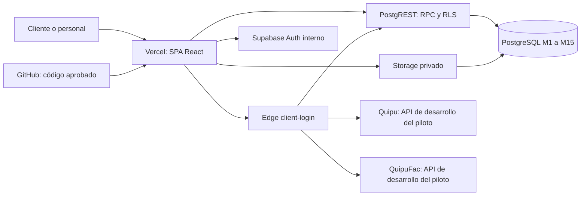
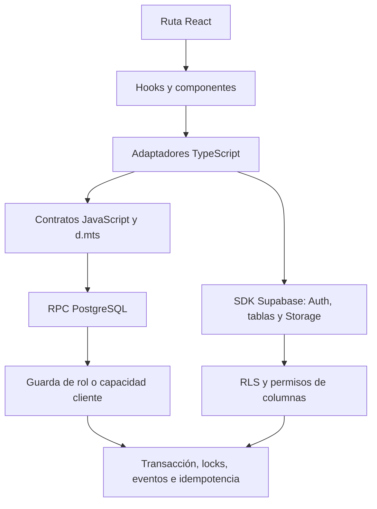
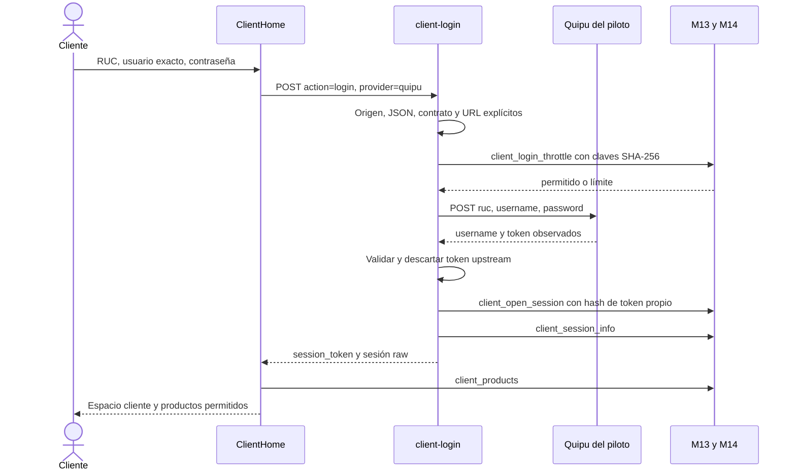
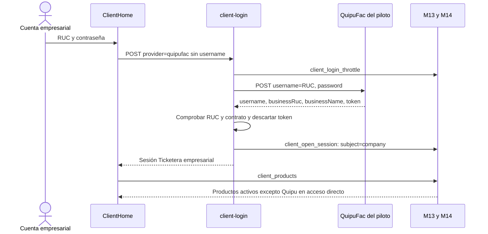
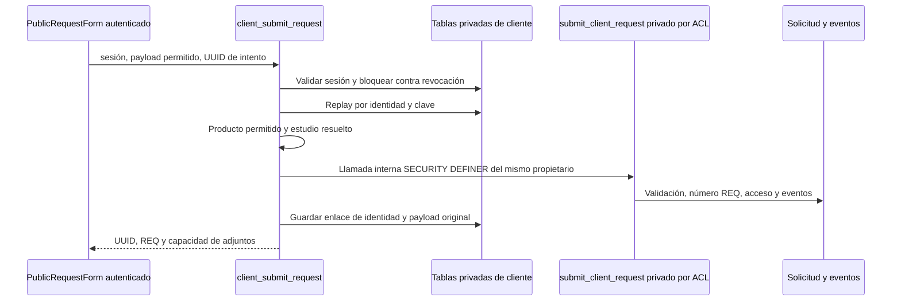
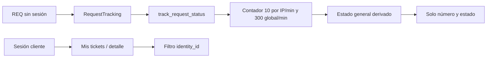
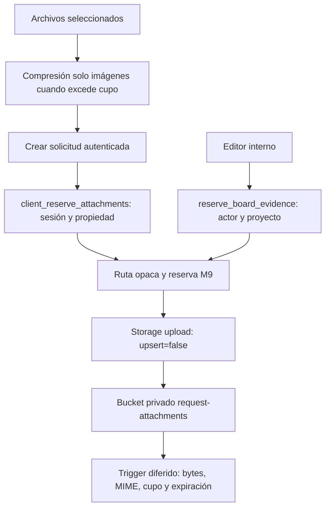
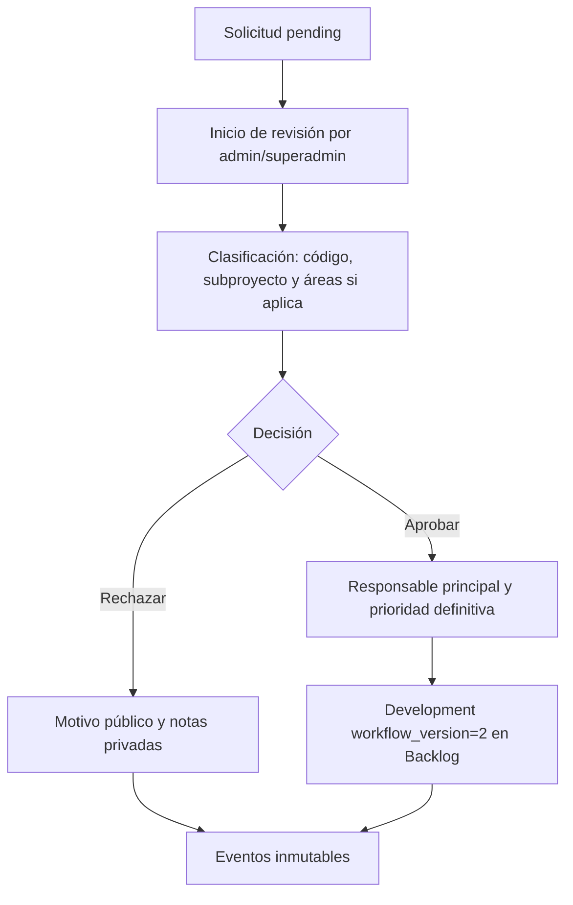
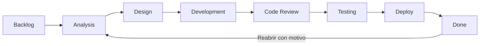
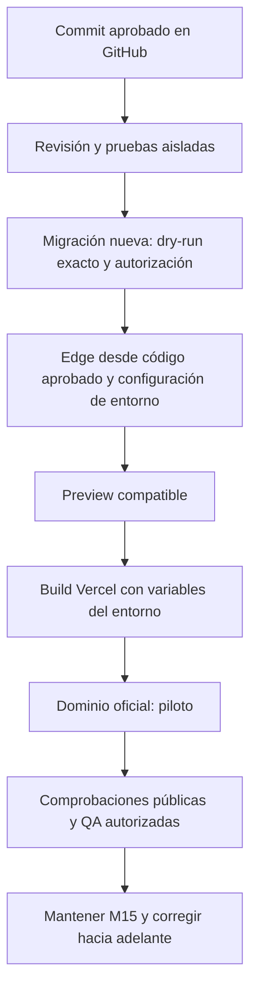

# Arquitectura técnica

Revisión: **20/11/2026** · Código de referencia: **`c857a727c8e7640bbce8daada940f973acbf013e`**.

Fuente oficial de requisitos: [PRODUCT_REQUIREMENTS.md](PRODUCT_REQUIREMENTS.md).

## Límites del sistema y dependencias

Ticketera es una SPA estática. React 18 y React Router 6 renderizan rutas; TypeScript comprueba contratos y Vite 5 compila assets. Tailwind 3 y `src/theme/brand.ts` centralizan estilo; `@hello-pangea/dnd` soporta Kanban, Recharts gráficos, `xlsx` el importador Planner y date-fns fechas de interfaz. Las versiones exactas instalables están en `package-lock.json`; no actualizar dependencias como efecto secundario de una edición documental.

Supabase aporta PostgreSQL 17, PostgREST/RPC, Auth interno, Realtime y Storage. Deno ejecuta las dos Edge Functions; ambas importan `@supabase/supabase-js@2.98.0` de forma explícita. El frontend declara otra versión compatible mediante su lockfile: no asumir que ambas instalaciones son la misma. Vercel sirve `dist` y GitHub conserva historial. Los servicios de Quipu/QuipuFac son dependencias externas, no parte modificable del repositorio.

## Frontend → adaptador → contrato → servidor

| Zona | Entrada UI | Adaptador | Autoridad backend |
|---|---|---|---|
| Clientes | `ClientHome`, `ClientWorkspace`, `ClientNewTicket`, `MyTickets`, `ClientTicketDetail` | `src/lib/client-portal-api.ts` → `client-portal.ts` → `contracts/client-access-client.mjs` | Edge `client-login`, RPC `client_*`, M13/M14/M15 |
| Personal | `LoginForm`, modal `PublicLanding`, `ProtectedRoute` | `useAuth`/`auth-controller` + `loadActiveProfile` | Supabase Auth + `public.users` + RLS/RPC |
| Solicitudes | `RequestInbox`, `RequestValidationModal`, `PlannerImportModal` | `src/lib/operations.ts`, `rpc-attempt.ts` | RPC de clasificación/decisión y M15 |
| Tablero | `KanbanBoard`, `ProjectModal`, `BoardDialogs` | `useBoardTicket`, `src/lib/board.ts`, `board-operations-client.mjs` | M12: snapshots y comandos transaccionales |
| Checklist/comentarios | `ChecklistSection`, `CommentsSection` | hooks y CRUD explícito del SDK | RLS; triggers de reloj/auditoría; menciones de UI |
| Métricas/exportación | `DashboardView`, `WorkloadView`, paneles de urgencia | `metrics-adapter.ts`, `ticket-export.ts`, contrato metrics | M11, consultas paginadas PostgREST |
| Adjuntos | `AttachmentPicker`, `EvidenceSection` | preparación → reserva → upload | RPC M9/M12/M13 + políticas y trigger final de Storage |

`src/types/database.types.ts` cubre el modelo usado por componentes, pero no sustituye al SQL ni a los `.d.mts` de contratos. Al ampliar un RPC, actualizar contrato, adaptador, tipos y pruebas conjuntamente; no inferir autorización desde un botón oculto.

## Login Quipu

## Login QuipuFac

La sesión **raw** de Edge tiene `identity` y `company` anidados y no contiene productos. `createClientPortal` combina esa respuesta con `client_products` y produce la sesión de UI con `ruc`, `studio_id`, `studio_mapping`, `auth_type`, `origin`, `identity`, `products`, `expires_at`. No implementar una segunda autenticación para obtener ese modelo.

## Creación autenticada y M15

M15 retira la ejecución **directa** del helper antiguo. No revoca `client_submit_request`, no modifica el cuerpo M13 ni cambia propietarios. Los tokens de cliente no son JWT de Supabase Auth. Las tablas privadas no son endpoints de lectura para el navegador.

## Seguimiento

`track_request_status` incrementa contadores de protección: una consulta pública no es una transacción SQL de solo lectura. No ejecutarla como una comprobación inocua de inventario cuando la autorización prohíbe escrituras.

## Adjuntos

## Validación interna

## Development

Las flechas muestran el recorrido nominal, no una obligación de avanzar exactamente una fase. M12 admite saltos y retrocesos; bloqueo impide cambios y Done tiene confirmación de checklist. Administrative/Dual existentes permanecen históricos. [Flujos detallados](WORKFLOWS_SPEC.md).

## Despliegue

Este es el procedimiento conceptual. El orden histórico de activación fue M14, función/frontend y después M15; **M1–M15 ya están aplicadas**, no volver a ejecutarlas. Las variables `VITE_*` se fijan al compilar; las privadas se leen en Edge. [Runbook](DEPLOYMENT_SPEC.md).

## Mantenimiento y restricciones de arquitectura

Conservar el UUID de intento frente a una respuesta incierta. No generar logs de auditoría desde el navegador. No reemplazar null estadístico por cero. No usar datos del proveedor como permisos internos. Mantener acciones de tablero en M12 y operaciones clientes en M13. Cualquier cambio de contratos externos requiere evidencia depurada y configuración explícita. Los scripts de preparación antiguos fijan fases históricas: su existencia no los convierte en instaladores universales M1–M15.

El inventario completo y los consumidores están en [CODE_INVENTORY.md](CODE_INVENTORY.md); todas las funciones SQL y tablas por migración en [DATABASE_SPEC.md](DATABASE_SPEC.md).

## Rutas y componentes

| Ruta | Parámetros / destino | Componente | Sesión y comportamiento |
|---|---|---|---|
| `/portal` | Dos tarjetas (Nueva Solicitud, Rastrear Solicitud) e ingreso interno; tres hasta el 23/11/2026 | `PublicLanding` | Público; botones navegan a cliente/tracking o abren modal separado. |
| `/cliente` | Query `ir=nuevo` o `ir=tickets` en lista blanca | `ClientHome` | Público; exactamente dos métodos; flag compilado controla disponibilidad. |
| `/cliente/nuevo` | Sin UUID de estudio en URL | `ClientWorkspace` + `ClientNewTicket` + `PublicRequestForm` | Capacidad válida; sin asociación muestra aviso y bloquea envío. |
| `/cliente/tickets` | Lista de identidad | `ClientWorkspace` + `MyTickets` | Capacidad válida; tabla escritorio/tarjetas móvil, primer lote de 100. |
| `/cliente/tickets/:id` | UUID del ticket | `ClientWorkspace` + `ClientTicketDetail` | Sesión y propiedad; ajeno/inexistente mismo PT404; no destruye sesión. |
| `/cliente/acceso/:provider` | provider quipu/quipufac y fragmento `#code=...` | `ClientLaunch` | Canje de un uso, elimina fragmento y confirma identidad; no supone secreto en navegador. |
| `/tracking` | REQ en formulario | `RequestTracking` | Público, solo número/estado; no comparte autenticación con Mis tickets. |
| `/request` | Redirección replace a `/cliente` | `Navigate` en App | Ningún formulario anónimo. |
| `/login` | Correo/contraseña internos | `LoginForm` | Supabase Auth y perfil activo; no login de cliente. |
| `/` | Dashboard/Boards/Requests/Equipo | `ProtectedRoute` + Dashboard en App | Personal con perfil activo; pestañas/subpestañas por rol. |
| Cualquier otra | Fallback a `/portal` | `Navigate` | No ruta que permita saltar autorizaciones de servidor. |

Un destino de detalle sin sesión vuelve por lista (`ir=tickets`), no se promete recuperar el UUID exacto después del login. El parámetro `ir` no es un redirect externo arbitrario. `BuildVersion` se renderiza fuera de App/ErrorBoundary en main para todas las rutas y pantallas de error, en flujo normal y sin posición fija.
